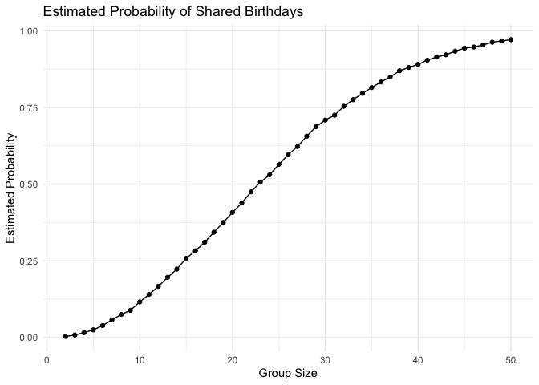
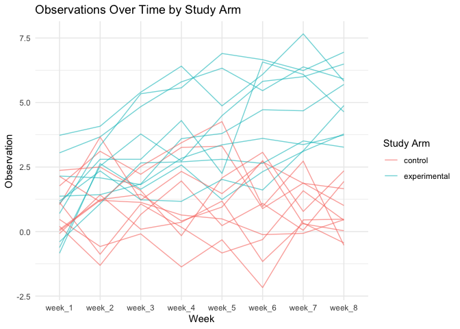
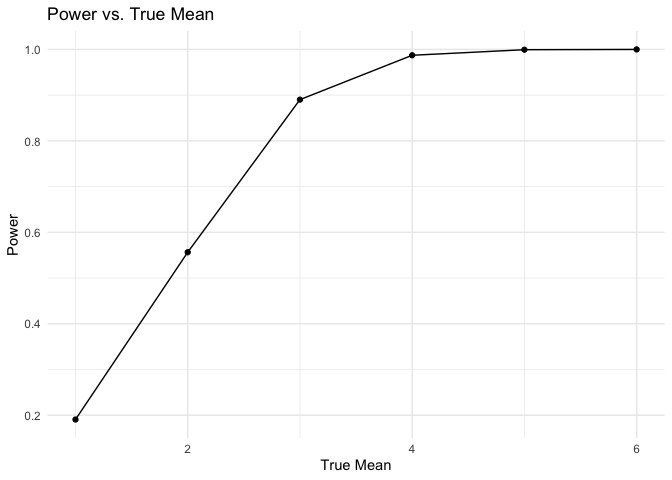
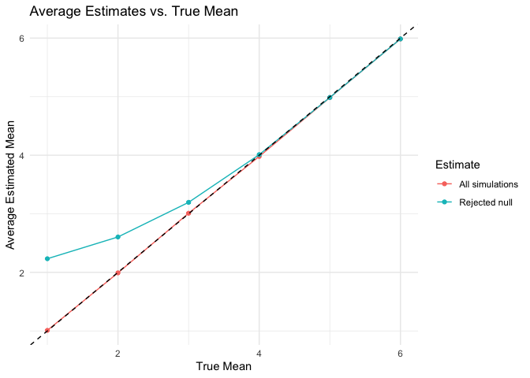

P8105 Homework 5
================
Vidhi Patel

``` r
library(tidyverse)
```

## Problem 1

### Birthday simulation

``` r
# Function to determine whether a group has at least
# two people sharing the same birthday
birthday_sim = function(n) {
  birthdays = sample(1:365, size = n, replace = TRUE)
  any(duplicated(birthdays))
}

# Simulate the birthday problem 10,000 times
# for group sizes from 2 to 50
set.seed(123)

birthday_results = tibble(
  group_size = 2:50
) |>
  mutate(
    simulations = map(
      group_size,
      ~ replicate(10000, birthday_sim(.x))
    ),
    probability = map_dbl(
      simulations,
      mean
    )
  )

# Plot estimated probabilities
ggplot(birthday_results,
       aes(x = group_size, y = probability)) +
  geom_line() +
  geom_point() +
  labs(
    title = "Estimated Probability of Shared Birthdays",
    x = "Group Size",
    y = "Estimated Probability"
  ) +
  theme_minimal()
```

<!-- -->

### Interpretation

The estimated probability of at least two people sharing a birthday
increases as the group size increases. This occurs because larger groups
have more possible pairs of individuals, increasing the chance of a
shared birthday. The probability reaches approximately 50% with a group
of 23 people and continues increasing as the group size grows.

## Problem 2

### Import and tidy the data

``` r
# Get the names of all CSV files
file_names =
  list.files(
    path = "data/data",
    pattern = "\\.csv$",
    full.names = TRUE
  )

# Create a dataframe containing filenames and imported data
study_data =
  tibble(
    file_name = file_names,
    arm = if_else(str_detect(file_names, "con"), "control", "experimental"),
    subject_id = str_extract(basename(file_names), "\\d+"),
    data = map(file_names, read_csv)
  )
```

    ## Rows: 1 Columns: 8
    ## ── Column specification ────────────────────────────────────────────────────────
    ## Delimiter: ","
    ## dbl (8): week_1, week_2, week_3, week_4, week_5, week_6, week_7, week_8
    ## 
    ## ℹ Use `spec()` to retrieve the full column specification for this data.
    ## ℹ Specify the column types or set `show_col_types = FALSE` to quiet this message.
    ## Rows: 1 Columns: 8
    ## ── Column specification ────────────────────────────────────────────────────────
    ## Delimiter: ","
    ## dbl (8): week_1, week_2, week_3, week_4, week_5, week_6, week_7, week_8
    ## 
    ## ℹ Use `spec()` to retrieve the full column specification for this data.
    ## ℹ Specify the column types or set `show_col_types = FALSE` to quiet this message.
    ## Rows: 1 Columns: 8
    ## ── Column specification ────────────────────────────────────────────────────────
    ## Delimiter: ","
    ## dbl (8): week_1, week_2, week_3, week_4, week_5, week_6, week_7, week_8
    ## 
    ## ℹ Use `spec()` to retrieve the full column specification for this data.
    ## ℹ Specify the column types or set `show_col_types = FALSE` to quiet this message.
    ## Rows: 1 Columns: 8
    ## ── Column specification ────────────────────────────────────────────────────────
    ## Delimiter: ","
    ## dbl (8): week_1, week_2, week_3, week_4, week_5, week_6, week_7, week_8
    ## 
    ## ℹ Use `spec()` to retrieve the full column specification for this data.
    ## ℹ Specify the column types or set `show_col_types = FALSE` to quiet this message.
    ## Rows: 1 Columns: 8
    ## ── Column specification ────────────────────────────────────────────────────────
    ## Delimiter: ","
    ## dbl (8): week_1, week_2, week_3, week_4, week_5, week_6, week_7, week_8
    ## 
    ## ℹ Use `spec()` to retrieve the full column specification for this data.
    ## ℹ Specify the column types or set `show_col_types = FALSE` to quiet this message.
    ## Rows: 1 Columns: 8
    ## ── Column specification ────────────────────────────────────────────────────────
    ## Delimiter: ","
    ## dbl (8): week_1, week_2, week_3, week_4, week_5, week_6, week_7, week_8
    ## 
    ## ℹ Use `spec()` to retrieve the full column specification for this data.
    ## ℹ Specify the column types or set `show_col_types = FALSE` to quiet this message.
    ## Rows: 1 Columns: 8
    ## ── Column specification ────────────────────────────────────────────────────────
    ## Delimiter: ","
    ## dbl (8): week_1, week_2, week_3, week_4, week_5, week_6, week_7, week_8
    ## 
    ## ℹ Use `spec()` to retrieve the full column specification for this data.
    ## ℹ Specify the column types or set `show_col_types = FALSE` to quiet this message.
    ## Rows: 1 Columns: 8
    ## ── Column specification ────────────────────────────────────────────────────────
    ## Delimiter: ","
    ## dbl (8): week_1, week_2, week_3, week_4, week_5, week_6, week_7, week_8
    ## 
    ## ℹ Use `spec()` to retrieve the full column specification for this data.
    ## ℹ Specify the column types or set `show_col_types = FALSE` to quiet this message.
    ## Rows: 1 Columns: 8
    ## ── Column specification ────────────────────────────────────────────────────────
    ## Delimiter: ","
    ## dbl (8): week_1, week_2, week_3, week_4, week_5, week_6, week_7, week_8
    ## 
    ## ℹ Use `spec()` to retrieve the full column specification for this data.
    ## ℹ Specify the column types or set `show_col_types = FALSE` to quiet this message.
    ## Rows: 1 Columns: 8
    ## ── Column specification ────────────────────────────────────────────────────────
    ## Delimiter: ","
    ## dbl (8): week_1, week_2, week_3, week_4, week_5, week_6, week_7, week_8
    ## 
    ## ℹ Use `spec()` to retrieve the full column specification for this data.
    ## ℹ Specify the column types or set `show_col_types = FALSE` to quiet this message.
    ## Rows: 1 Columns: 8
    ## ── Column specification ────────────────────────────────────────────────────────
    ## Delimiter: ","
    ## dbl (8): week_1, week_2, week_3, week_4, week_5, week_6, week_7, week_8
    ## 
    ## ℹ Use `spec()` to retrieve the full column specification for this data.
    ## ℹ Specify the column types or set `show_col_types = FALSE` to quiet this message.
    ## Rows: 1 Columns: 8
    ## ── Column specification ────────────────────────────────────────────────────────
    ## Delimiter: ","
    ## dbl (8): week_1, week_2, week_3, week_4, week_5, week_6, week_7, week_8
    ## 
    ## ℹ Use `spec()` to retrieve the full column specification for this data.
    ## ℹ Specify the column types or set `show_col_types = FALSE` to quiet this message.
    ## Rows: 1 Columns: 8
    ## ── Column specification ────────────────────────────────────────────────────────
    ## Delimiter: ","
    ## dbl (8): week_1, week_2, week_3, week_4, week_5, week_6, week_7, week_8
    ## 
    ## ℹ Use `spec()` to retrieve the full column specification for this data.
    ## ℹ Specify the column types or set `show_col_types = FALSE` to quiet this message.
    ## Rows: 1 Columns: 8
    ## ── Column specification ────────────────────────────────────────────────────────
    ## Delimiter: ","
    ## dbl (8): week_1, week_2, week_3, week_4, week_5, week_6, week_7, week_8
    ## 
    ## ℹ Use `spec()` to retrieve the full column specification for this data.
    ## ℹ Specify the column types or set `show_col_types = FALSE` to quiet this message.
    ## Rows: 1 Columns: 8
    ## ── Column specification ────────────────────────────────────────────────────────
    ## Delimiter: ","
    ## dbl (8): week_1, week_2, week_3, week_4, week_5, week_6, week_7, week_8
    ## 
    ## ℹ Use `spec()` to retrieve the full column specification for this data.
    ## ℹ Specify the column types or set `show_col_types = FALSE` to quiet this message.
    ## Rows: 1 Columns: 8
    ## ── Column specification ────────────────────────────────────────────────────────
    ## Delimiter: ","
    ## dbl (8): week_1, week_2, week_3, week_4, week_5, week_6, week_7, week_8
    ## 
    ## ℹ Use `spec()` to retrieve the full column specification for this data.
    ## ℹ Specify the column types or set `show_col_types = FALSE` to quiet this message.
    ## Rows: 1 Columns: 8
    ## ── Column specification ────────────────────────────────────────────────────────
    ## Delimiter: ","
    ## dbl (8): week_1, week_2, week_3, week_4, week_5, week_6, week_7, week_8
    ## 
    ## ℹ Use `spec()` to retrieve the full column specification for this data.
    ## ℹ Specify the column types or set `show_col_types = FALSE` to quiet this message.
    ## Rows: 1 Columns: 8
    ## ── Column specification ────────────────────────────────────────────────────────
    ## Delimiter: ","
    ## dbl (8): week_1, week_2, week_3, week_4, week_5, week_6, week_7, week_8
    ## 
    ## ℹ Use `spec()` to retrieve the full column specification for this data.
    ## ℹ Specify the column types or set `show_col_types = FALSE` to quiet this message.
    ## Rows: 1 Columns: 8
    ## ── Column specification ────────────────────────────────────────────────────────
    ## Delimiter: ","
    ## dbl (8): week_1, week_2, week_3, week_4, week_5, week_6, week_7, week_8
    ## 
    ## ℹ Use `spec()` to retrieve the full column specification for this data.
    ## ℹ Specify the column types or set `show_col_types = FALSE` to quiet this message.
    ## Rows: 1 Columns: 8
    ## ── Column specification ────────────────────────────────────────────────────────
    ## Delimiter: ","
    ## dbl (8): week_1, week_2, week_3, week_4, week_5, week_6, week_7, week_8
    ## 
    ## ℹ Use `spec()` to retrieve the full column specification for this data.
    ## ℹ Specify the column types or set `show_col_types = FALSE` to quiet this message.

``` r
# Combine all observations and reshape into tidy format
study_tidy =
  study_data |>
  unnest(data) |>
  pivot_longer(
    cols = starts_with("week_"),
    names_to = "week",
    values_to = "observation"
  ) |>
  mutate(
    week = factor(week, levels = paste0("week_", 1:8))
  )

# Display the tidy dataset
study_tidy
```

    ## # A tibble: 160 × 5
    ##    file_name            arm     subject_id week   observation
    ##    <chr>                <chr>   <chr>      <fct>        <dbl>
    ##  1 data/data/con_01.csv control 01         week_1        0.2 
    ##  2 data/data/con_01.csv control 01         week_2       -1.31
    ##  3 data/data/con_01.csv control 01         week_3        0.66
    ##  4 data/data/con_01.csv control 01         week_4        1.96
    ##  5 data/data/con_01.csv control 01         week_5        0.23
    ##  6 data/data/con_01.csv control 01         week_6        1.09
    ##  7 data/data/con_01.csv control 01         week_7        0.05
    ##  8 data/data/con_01.csv control 01         week_8        1.94
    ##  9 data/data/con_02.csv control 02         week_1        1.13
    ## 10 data/data/con_02.csv control 02         week_2       -0.88
    ## # ℹ 150 more rows

### Spaghetti plot

``` r
study_tidy |>
  ggplot(
    aes(
      x = week,
      y = observation,
      group = interaction(arm, subject_id),
      color = arm
    )
  ) +
  geom_line(alpha = 0.6) +
  labs(
    title = "Observations Over Time by Study Arm",
    x = "Week",
    y = "Observation",
    color = "Study Arm"
  ) +
  theme_minimal()
```

<!-- -->
The spaghetti plot suggests that observations in the experimental group
generally increase over time, whereas the control group tends to remain
at lower levels. Although there is variability among individual
participants in both groups, the experimental group shows a more
pronounced upward trend, suggesting a potential difference in outcomes
between the two study arms.

# Problem 3

## Simulation

``` r
set.seed(123)

n = 30
sigma = 5
n_sim = 5000

mu_values = 0:6

simulate_data = function(mu) {
  x = rnorm(n, mean = mu, sd = sigma)

  broom::tidy(t.test(x, mu = 0)) |>
    select(estimate, p.value)
}

simulation_results =
  expand_grid(
    mu = mu_values,
    simulation = 1:n_sim
  ) |>
  mutate(
    results = map(mu, simulate_data)
  ) |>
  unnest(results)
```

``` r
#Calculate power and average estimates

simulation_summary = simulation_results %>%
  mutate(reject_null = p.value < 0.05) %>%
  group_by(mu) %>%
  summarize(
    power = mean(reject_null),
    average_estimate = mean(estimate),
    average_estimate_rejected = if (any(reject_null)) {
      mean(estimate[reject_null])
    } else {
      NA_real_
    },
    .groups = "drop"
  )

simulation_summary
```

    ## # A tibble: 7 × 4
    ##      mu  power average_estimate average_estimate_rejected
    ##   <int>  <dbl>            <dbl>                     <dbl>
    ## 1     0 0.0446          0.00900                     0.147
    ## 2     1 0.191           1.01                        2.23 
    ## 3     2 0.556           1.99                        2.60 
    ## 4     3 0.890           3.01                        3.20 
    ## 5     4 0.987           3.98                        4.01 
    ## 6     5 0.999           4.98                        4.99 
    ## 7     6 1               5.99                        5.99

``` r
#Plot power versus true mean

simulation_summary %>%
  filter(mu > 0) %>%
  ggplot(aes(x = mu, y = power)) +
  geom_point() +
  geom_line() +
  labs(
    title = "Power vs. True Mean",
    x = "True Mean",
    y = "Power"
  ) +
  theme_minimal()
```

<!-- -->

``` r
#Plot average estimates versus true mean

simulation_summary %>%
  filter(mu > 0) %>%
  ggplot(aes(x = mu)) +
  geom_line(
    aes(y = average_estimate, color = "All simulations")
  ) +
  geom_point(
    aes(y = average_estimate, color = "All simulations")
  ) +
  geom_line(
    aes(y = average_estimate_rejected, color = "Rejected null")
  ) +
  geom_point(
    aes(y = average_estimate_rejected, color = "Rejected null")
  ) +
  geom_abline(
    intercept = 0,
    slope = 1,
    linetype = "dashed"
  ) +
  labs(
    title = "Average Estimates vs. True Mean",
    x = "True Mean",
    y = "Average Estimated Mean",
    color = "Estimate"
  ) +
  theme_minimal()
```

<!-- -->

The estimated power increases as the true population mean increases.
When the true mean is close to zero, the probability of rejecting the
null hypothesis is relatively low. As the true mean increases, the test
becomes more likely to detect a statistically significant difference.

The average estimated mean across all simulations is close to the true
population mean, indicating that the sample mean is approximately
unbiased. However, among simulations where the null hypothesis is
rejected, the average estimates tend to be higher than the true mean,
particularly for smaller effect sizes. This occurs because selecting
only statistically significant results introduces selection bias.
